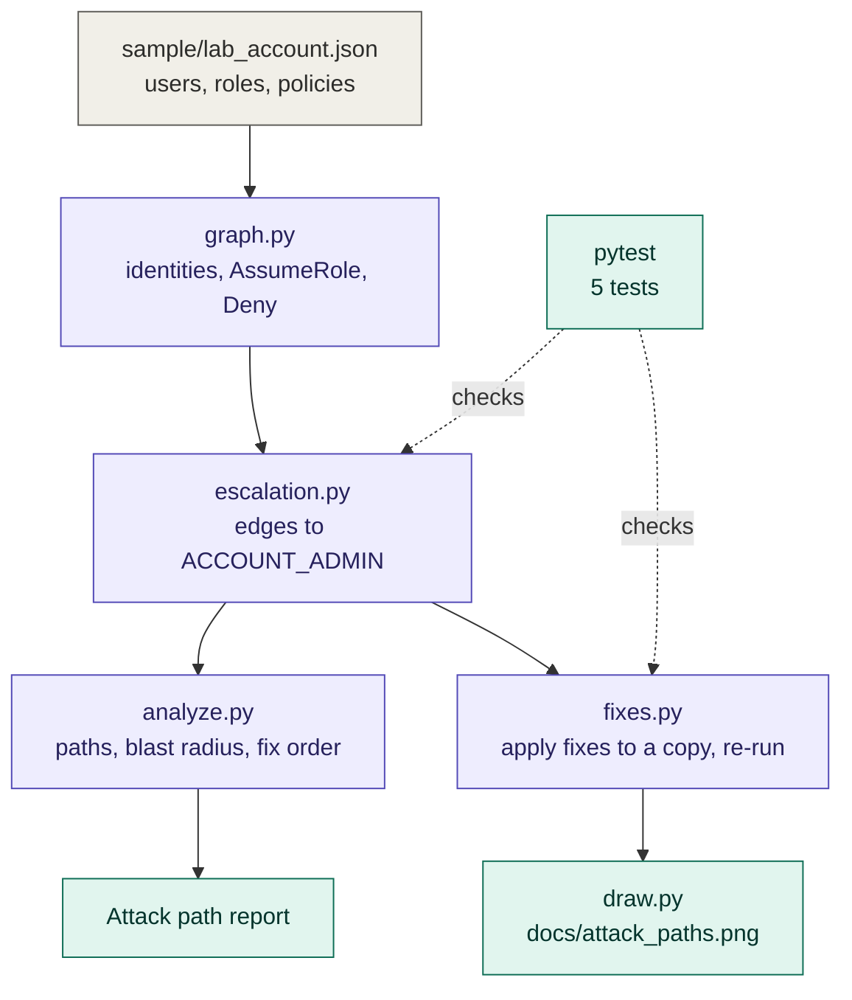

# IAM Attack-Path Analyzer: Finding Privilege Escalation Before an Attacker Does

A small, tested tool that reads an AWS IAM configuration, builds a graph of "who can become whom", and finds every path from a low-privilege identity to full admin. It then recommends which fix to make first and proves, on a copy of the account, that the fixes remove every path.

It runs entirely offline on JSON files. No AWS account is needed.


**Why I built it:** most cloud breaches don't start with a clever exploit. They start with an identity that has slightly too much permission, plus a route from it to something more powerful. Those routes are hard to see by reading policies one at a time. In my [detection-as-code project](https://github.com/YOUR-USERNAME/cloud-detection-as-code) I found an attack after it happened. This project is the other side: finding the paths before anyone walks them.

---

## Contents

- [Results at a glance](#results-at-a-glance)
- [Architecture](#architecture)
- [The sample account](#the-sample-account)
- [How I built it, step by step](#how-i-built-it-step-by-step)
- [What the tool found](#what-the-tool-found)
- [How the tool improved (and why)](#how-the-tool-improved-and-why)
- [Problems I hit](#problems-i-hit)
- [Limitations](#limitations)
- [Run it yourself](#run-it-yourself)
- [Project layout](#project-layout)
- [What I'd do next](#what-id-do-next)
- [Credits](#credits)

---

## Results at a glance

| Measure | Result |
|---|---|
| Identities analyzed | 7 (4 users, 3 roles) |
| Attack paths to admin found | 4 |
| Identities with a path | alice (2 routes), bob (1), dev-role (1) |
| Identities correctly left alone | dave, lambda-basic-role |
| Best single fix | Remove `iam:AttachUserPolicy` from dev-role (sits on 2 of 4 paths) |
| Fixes needed to remove every path | 3 |
| Paths after the three fixes | 0 |
| Automated tests | 5 passing |

---

## Architecture



**How to read it:** the account is loaded once into a graph (`graph.py`). Escalation rules then add edges for dangerous permission combinations, ending at a special `ACCOUNT_ADMIN` node (`escalation.py`). Two things run on that graph: the analysis (`analyze.py`) and the fix check (`fixes.py`), which changes a *copy* of the account and re-runs the whole analysis. The tests check both.

---

## The sample account

A fictional AWS account with deliberate mistakes, so I know what the tool should find. Real exports are more verbose; this format is simplified on purpose (see [Limitations](#limitations)).

| Identity | Type | What they can do | Intended result |
|---|---|---|---|
| alice | user | Pass a role and create and invoke Lambda functions; assume `dev-role` | Two routes to admin |
| bob | user | `iam:CreatePolicyVersion` | One route: rewrite a policy to give himself admin |
| carol | user | `*` on `*` | Already an admin; a finding, but not a path |
| dave | user | Read-only S3 | The safe control: the tool must say nothing |
| dev-role | role | `iam:AttachUserPolicy` | One route: attach an admin policy |
| lambda-admin-role | role | `*` on `*` | Admin; the target of alice's Lambda route |
| lambda-basic-role | role | Logging only | Harmless |

A role also needs to *trust* whoever tries to become it, so each role lists who may assume it.

---

## How I built it, step by step

### 1. Read the data before writing any analysis

I wrote a small script that printed each identity's actions and each role's trust. Before running anything smarter, I guessed which identities were dangerous just by reading the JSON. I spotted bob and `dev-role` but **missed alice's PassRole-plus-Lambda route entirely**. That miss is the argument for building the tool.

### 2. Build the graph (`graph.py`)

Each user and role is a node. An arrow from A to B means "A can become B". For `sts:AssumeRole` an arrow needs **both** halves, as in real AWS:

1. A is *allowed to call* `sts:AssumeRole` on B, **and**
2. B's trust policy *names* A.

Result: 7 identities and one arrow (alice to dev-role). The graph looked almost empty, because most dangerous paths here don't use `AssumeRole`.

### 3. Add the escalation rules (`escalation.py`)

Two kinds of dangerous permission, plus one shortcut:

- **Self-escalation:** `iam:CreatePolicyVersion`, `iam:AttachUserPolicy` and `iam:PutUserPolicy` let an identity rewrite its own power. They draw an arrow straight to a special `ACCOUNT_ADMIN` goal node.
- **PassRole plus Lambda:** an identity that can create *and* invoke a Lambda function, and can pass a role to it, can run code as that role. It draws an arrow to each Lambda-trusted role it may pass.
- **Already admin:** an identity with `*` on `*` is marked as an admin and skipped by the escalation rules.

This produced 7 arrows. Dave and `lambda-basic-role` had none leaving them, as intended.

### 4. Find paths, rank, and choose fixes (`analyze.py`)

- **Attack paths:** every chain from a non-admin identity to `ACCOUNT_ADMIN`, including multi-hop chains.
- **Blast radius:** how many identities each one can reach.
- **Fix-first ranking:** which single edge sits on the most paths.

### 5. Prove the fixes work (`fixes.py`)

Instead of just recommending changes, the tool applies them to a **copy** of the account and re-runs the analysis. The original file is never touched.

### 6. Tests, then a picture

Five tests lock in the results. After that, `draw.py` draws before and after side by side.

---

## What the tool found

```
ATTACK PATHS
  alice -> dev-role -> ACCOUNT_ADMIN
  alice -> lambda-admin-role -> ACCOUNT_ADMIN
  bob -> ACCOUNT_ADMIN
  dave: no path to admin
  dev-role -> ACCOUNT_ADMIN
  lambda-basic-role: no path to admin

BLAST RADIUS (what each identity can reach)
  alice              reaches 4   routes to admin: 2
  bob                reaches 1   routes to admin: 1
  dev-role           reaches 1   routes to admin: 1
  dave               reaches 0   routes to admin: 0
  lambda-basic-role  reaches 0   routes to admin: 0

FIX FIRST (edges that sit on the most paths)
  2 path(s): dev-role -> ACCOUNT_ADMIN   (iam:AttachUserPolicy)
  1 path(s): alice -> dev-role   (sts:AssumeRole)
  1 path(s): alice -> lambda-admin-role   (PassRole + Lambda)
  1 path(s): bob -> ACCOUNT_ADMIN   (iam:CreatePolicyVersion)
```

**My instinct and the data disagreed.** I thought I'd fix bob first, because his one-step route to admin looked like the scariest. The tool showed that `dev-role`'s `AttachUserPolicy` sits on two paths (its own, and alice's route through it), so removing it cuts half of all routes. `dev-role` looks harmless on its own, which is exactly why it is easy to overlook.

**Alice needs two fixes, not one.** She has two independent routes, so fixing only the top choke point leaves her an admin. A test proves this.

**The three fixes:**

1. Remove `iam:AttachUserPolicy` from `dev-role`. This removes two paths.
2. Scope alice's `iam:PassRole` to `lambda-basic-role` only, instead of `*`.
3. Remove `iam:CreatePolicyVersion` from bob.

After all three, the tool reports **0 paths to admin**.

---

## How the tool improved (and why)

### A test exposed a gap, and I fixed it

I wrote a test for explicit Deny statements before the tool supported them. In real AWS an explicit Deny beats any Allow, so a tool that ignores Deny reports paths that AWS would block (a false alarm).

1. I marked the test `xfail`, an "expected to fail" marker, so the known gap was documented rather than hidden. The suite showed 4 passed, 1 xfailed.
2. I changed `action_allowed` to return `False` as soon as it meets a matching Deny.
3. I removed the `xfail` marker and the test passed: 5 passed, nothing else changed.

### The first picture was misleading

My first version drew an arrow from every admin to `ACCOUNT_ADMIN`. One of those arrows passed behind the `dev-role` node, so the "after" picture looked as if `dev-role` still led to admin, even though the analysis said 0 paths. I fixed it by not drawing edges that leave admins (they already have full access) and rearranging the nodes so no arrow passes behind another one. A diagram that contradicts the analysis is worse than no diagram.

---

## Problems I hit

| Problem | Cause | Fix |
|---|---|---|
| `fixes.py` printed output when imported by the tests | The before-and-after code ran at module level | Wrapped it in `if __name__ == "__main__":` |
| Arrows hid behind nodes in the first picture | Straight lines between fixed positions passed through other nodes | Moved the nodes and stopped drawing admin-to-goal arrows |
| Long names overflowed the circles | Node size too small for labels like `lambda-admin-role` | Increased node size |
| `OSError: [Errno 22]` when saving the PNG on Windows | Most likely the previous image was still open in a viewer, which locks the file | Closed the viewer and re-ran (I didn't isolate the exact cause) |

---

## Limitations

- **The input is a simplified JSON format**, not a raw AWS export. Real accounts would need a converter for `aws iam get-account-authorization-details`.
- **Only a few techniques are modelled:** `sts:AssumeRole`, three self-escalation permissions, and PassRole plus Lambda. AWS has many more documented escalation techniques, so "0 paths" means "0 paths among the techniques this tool knows", not "safe".
- **Condition blocks are ignored.** A permission that requires MFA or a source IP is treated as unconditional, which can cause false alarms.
- **Service control policies, permission boundaries and resource policies are not modelled.** Any of them can block a path the tool reports.
- **Deny is only partly handled.** It's respected when checking individual permissions, but `is_admin` still reads only Allow statements, so an admin with a Deny on one action still counts as a full admin.
- **The recommended fixes are applied by hand-written code in `fixes.py`.** The tool *ranks* choke points, but it doesn't generate the fixes automatically.
- **Path enumeration won't scale to large accounts.** `all_simple_paths` can explode on big, densely connected graphs. This lab account has 7 identities.
- **The account is fictional.** The results show the tool works on deliberate mistakes. They say nothing about how common these mistakes are in real accounts.
- **Wildcard matching is basic.** It uses simple pattern matching and doesn't handle every IAM policy feature.

---

## Run it yourself

Tested on Windows with PowerShell and Python 3.13.

```powershell
# 1. Install dependencies
pip install -r requirements.txt

# 2. Read the sample account
python explore.py

# 3. Build the graph, then add escalation edges
python graph.py
python escalation.py

# 4. Find paths, blast radius and the fix order
python analyze.py

# 5. Apply the fixes to a copy and re-run
python fixes.py

# 6. Draw the before and after picture
python draw.py

# 7. Run the tests
python -m pytest -v
```

## Project layout

```
iam-attack-paths/
├── sample/
│   └── lab_account.json    # fictional account with deliberate mistakes
├── tests/
│   └── test_paths.py       # 5 tests, including the Deny case
├── docs/
│   └── attack_paths.png    # before and after picture
├── graph.py                # identities, AssumeRole edges, Deny handling
├── escalation.py           # edges to the ACCOUNT_ADMIN goal node
├── analyze.py              # attack paths, blast radius, fix order
├── fixes.py                # applies fixes to a copy and re-runs
├── draw.py                 # draws the picture
├── explore.py              # prints the raw account
├── requirements.txt
└── README.md
```

## What I'd do next

1. **Write a converter** for real `get-account-authorization-details` output, so the tool can read actual accounts.
2. **Add more escalation techniques**, such as `iam:CreateAccessKey`, `iam:UpdateAssumeRolePolicy` and `iam:PassRole` combined with other services.
3. **Model conditions, permission boundaries and service control policies** to cut false alarms.
4. **Generate fix suggestions automatically** instead of applying hand-written ones.
5. **Add GitHub Actions** so the tests run on every push.

## Credits

- Privilege escalation techniques are publicly documented, including by Rhino Security Labs' research on AWS IAM escalation methods.
- Related tools worth a look: PMapper and Cloudsplaining, which solve this problem for real accounts.
- Built with [networkx](https://networkx.org/) and [matplotlib](https://matplotlib.org/).
